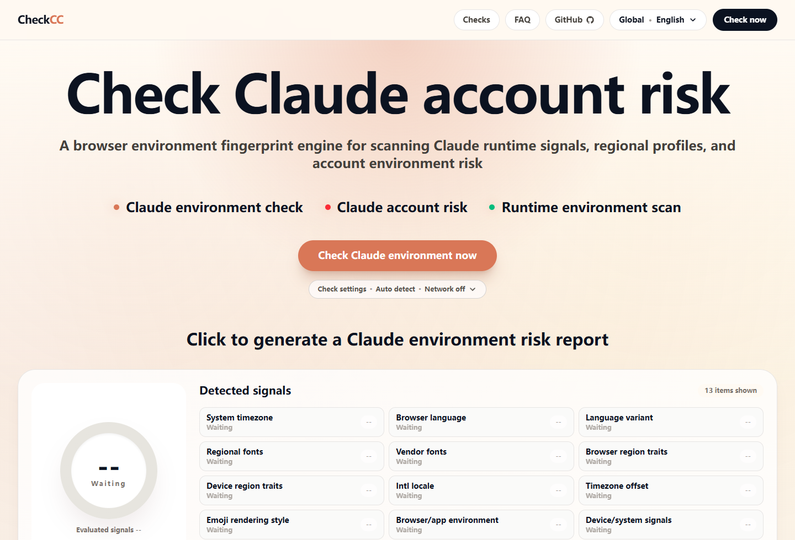
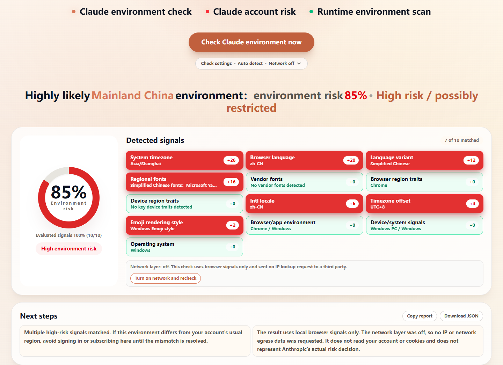
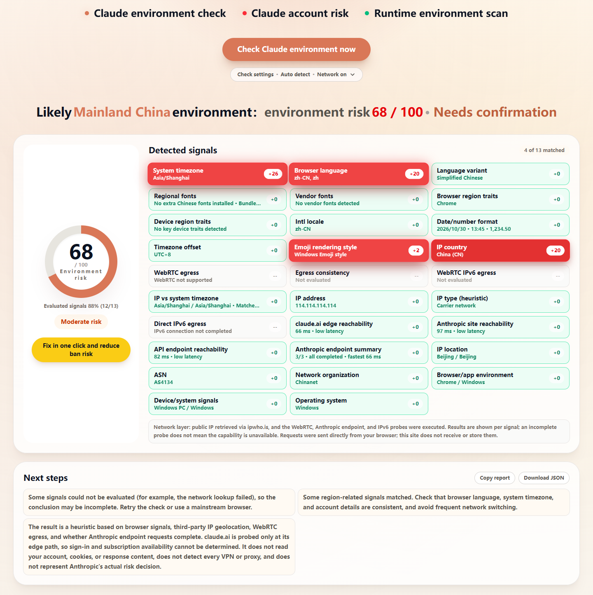
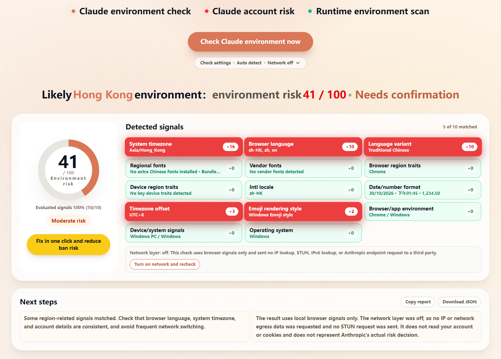
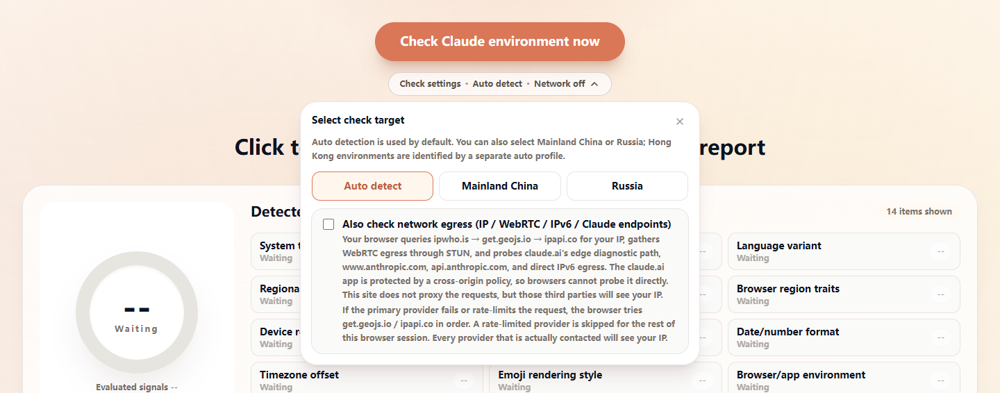
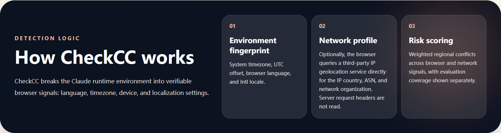
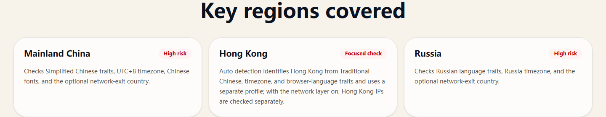
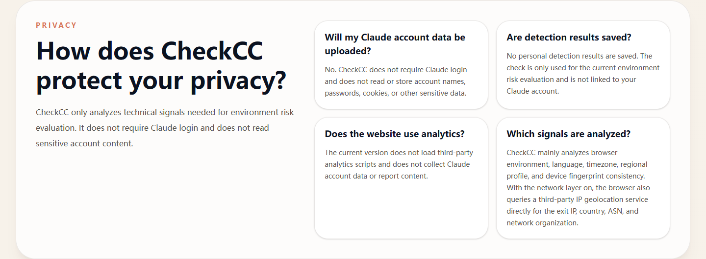

<!-- CheckCC English project documentation: purpose, capability boundaries, development, and deployment for open-source users. -->
# CheckCC

<p align="center">
  <strong>Check Claude account risk by inspecting your browser environment profile</strong>
</p>

<p align="center">
  Browser-side environment fingerprinting · Mainland China / Hong Kong / Russia / Iran profiles · Optional IP / WebRTC network layer · Static self-hosting
</p>

<p align="center">
  <a href="#overview">Overview</a> ·
  <a href="#screenshots">Screenshots</a> ·
  <a href="#how-it-works">How it works</a> ·
  <a href="#quick-start">Quick start</a> ·
  <a href="#self-hosting">Self-hosting</a> ·
  <a href="README.md">中文</a>
</p>

---

## 📖 Overview

**CheckCC** is a browser-side Claude environment checker. It looks for obvious conflicts between system timezone, browser language, Intl locale, fonts, device traits, and network egress. It does not log in to Claude, read your account, cookies, or chats, and it does not upload results to a server.

This repository is a community fork of [yacuo/check-cc](https://github.com/yacuo/check-cc), maintained by [Brilliant666](https://github.com/Brilliant666). This fork prioritizes trustworthy reporting: unevaluated signals are no longer scored as zero risk, the report shows evaluable coverage, the network layer is off by default and opt-in, Hong Kong environments use a separate profile instead of mainland China, and the opt-in network layer can also compare WebRTC egress, dual-stack IPv6 egress, Claude endpoint reachability, and the IP timezone. All new direct probes are context only and never change the weighted score.

> Results are heuristic risk hints, not an official Claude or Anthropic judgment. They cannot prove that an account is safe or will be restricted.

### ✨ Highlights

- 🔍 **10 weighted browser signals**: system timezone, browser language, language variant, regional fonts, vendor fonts, browser region traits, device region traits, Intl locale, timezone offset, and emoji rendering style.
- 🇭🇰 **Mainland China / Hong Kong / Russia / Iran profiles**: auto detection matches them separately. Traditional Chinese, a Hong Kong timezone, and a `zh-HK` locale map to Hong Kong instead of mainland China.
- 🌐 **Optional network layer**: off by default. After a browser-only result, choose "Turn on network and recheck" to query a third-party IP geolocation service directly from the browser.
- 🧭 **WebRTC egress check**: with the network layer on, ICE candidates are gathered through STUN and compared with the HTTP exit; public IPv6 candidates and IP-vs-system timezone mismatches are reported separately. Probe failures only reduce coverage and never raise or lower the risk score.
- 🛰️ **Claude endpoint reachability**: with the network layer on, the browser connects directly to claude.ai's Cloudflare edge diagnostic path, `www.anthropic.com`, and `api.anthropic.com`, recording only whether the request completes and how long it takes, then highlighting the fastest result. The `no-cors` probe does not read response content. The claude.ai app is protected by a cross-origin (CORP) policy and cannot be probed directly, so edge reachability does not prove sign-in or subscription availability.
- 🧩 **Dual-stack egress and egress type**: an IPv6-only lookup reads the direct IPv6 exit and compares it with the HTTP exit in the same address family; ASN and network organization names suggest residential, carrier, datacenter, or unknown. Both are zero-weight context.
- 🧾 **Localization format context**: reads the browser's actual date, time, and number formats as regional-profile context without affecting the score.
- 📊 **Coverage and not-evaluated states**: only signals with actual values are scored; missing signals neither raise nor lower the score, and coverage is shown separately.
- 🧾 **Report export**: copy a text report or download JSON with score, coverage, raw values, weights, contributions, recommendations, and limitations.
- 🌏 **Four UI languages**: Simplified Chinese, Traditional Chinese, Russian, and English, each with its own URL and `html lang`.
- 🛡️ **Privacy-first**: no Claude login, no account content, and no third-party analytics scripts.
- 📦 **Static export**: Next.js exports to `out/`, deployable to any static host with no Node server runtime.
- 🐳 **One-command VPS deploy**: Docker Compose + Nginx, listening on 8080 by default; bind address, port, domain, and TLS are configured for your environment.

> Maintained by **Brilliant666**, based on MIT-licensed code from yacuo/check-cc.

## 📸 Screenshots

### 🏠 Landing page: start with one click



The landing page exposes the check immediately. Auto detection is the default, and the network layer is off.

### 🔍 Browser-only result



The result lists matched signals, weight contributions, the risk score, and coverage. The example above is a mainland-China-style environment with `10/10` coverage and no IP lookup sent to a third party; the score depends on which signals match.

### 🌐 Network layer enabled



After "Turn on network and recheck", the browser queries `ipwho.is` directly for your public IP. If the primary endpoint fails or is rate-limited, it automatically falls back to `ipapi.co`, and the notice shows which service was actually used. The same run gathers WebRTC egress candidates through STUN, queries the direct IPv6 exit, and probes the three Anthropic endpoints, then cross-checks them against the HTTP exit and IP timezone. Weighted signals still top out at `13/13`; the signal panel shows at most 29 rows (14 browser + 15 network), of which only IP country, WebRTC egress, and IP timezone are weighted. When WebRTC is unsupported, STUN is blocked, or no comparable candidate exists, those signals are marked "not evaluated" and coverage drops; endpoint or IPv6 failures only affect their own zero-weight signals.

### 🇭🇰 Hong Kong profile



Traditional Chinese, a Hong Kong timezone, and a `zh-HK` locale map to the Hong Kong profile, labeled "Hong Kong" rather than "Mainland China". This browser-only example is rated moderate risk and needs confirmation; Hong Kong is auto-detected, not a manual target, and with the network layer on a Hong Kong IP is checked separately.

### ⚙️ Inline check settings



Target selection, the network toggle, and the privacy note expand inline instead of opening a modal. Changing the target clears the current result and requires another check.

### 🧠 Detection logic and key regions

| Detection logic | Key regions |
| --- | --- |
|  |  |

## 🎯 How it works

1. **Collect browser environment**: read `navigator.languages`, `Intl.DateTimeFormat().resolvedOptions()`, timezone offset, User-Agent, UA-CH brands, and Canvas font probes.
2. **Match regional profiles**: score overlap against each profile using language, timezone, Intl locale, browser, and device traits, then select the best match.
3. **Score weighted signals**: only weighted signals with actual values participate; missing or failed signals are marked "not evaluated".
4. **Optional network layer**: when enabled, the browser queries a third-party IP geolocation service directly for IP country, ASN, organization, and location, gathers WebRTC candidates through STUN, reads the direct IPv6 exit from an IPv6-only lookup, and probes Anthropic endpoints directly for reachability and latency, then compares HTTP / WebRTC / IPv6 egress and the IP timezone.
5. **Generate recommendations and reports**: build next-step advice from the score, coverage, and limitations, then copy text or download JSON.

### Weighted signals

| Signal | Weight | Notes |
| --- | ---: | --- |
| System timezone | 26 | Whether the system timezone matches the profile |
| Browser language | 20 | Whether the preferred language matches the target region |
| IP country | 20 | Optional network signal, only when the network layer is on |
| WebRTC egress | 18 | Optional network signal; scores when no same-family public candidate equals the HTTP exit. Extra exits are shown as context |
| Regional fonts | 16 | Chinese fonts that need a separate install. Fonts bundled with Windows / macOS / Linux (YaHei, SimSun, PingFang, etc.) are shown but not scored |
| Language/script traits | 12 | Simplified or Traditional Chinese traits |
| Vendor fonts | 10 | MiSans, HarmonyOS Sans, OPPO Sans, and similar |
| Browser regional traits | 8 | WeChat, QQ, UC, Quark, and other Chinese browsers or WebViews |
| Device regional traits | 6 | Huawei, Honor, Xiaomi, OPPO, vivo, and similar clues |
| Intl locale | 6 | Region exposed by the JavaScript internationalization environment |
| Timezone offset | 4 | Whether the UTC offset matches the profile |
| Emoji rendering style | 4 | Apple / Android / Windows emoji style |
| IP vs. system timezone | 4 | Optional network signal; scores when the IP timezone and browser timezone have different UTC offsets. IANA aliases with the same offset count as consistent |

Browser/app environment, device/system clues, operating system, and date/number format are four browser context signals. IP address, IP location, ASN, network organization, egress consistency, WebRTC IPv6 egress, egress type, direct IPv6 egress, three endpoint probes (claude.ai edge / site / API), and the endpoint summary are twelve network context signals. None of these sixteen rows affect the score.

### Scoring

- The score is the sum of evaluated contributions, capped at 100 and shown as "xx / 100". It is a heuristic sum, not a probability. Unevaluated signals neither raise nor lower it.
- Signals that measure the same thing are grouped, and a group's total contribution never exceeds its largest weight: system timezone + timezone offset (cap 26), browser language + language/script + Intl locale (cap 20), regional fonts + vendor fonts (cap 16). The browser layer tops out at 80.
- Levels: 70 and above is high, 31–69 moderate, 1–30 light. The page, the report, and the recommendations share these thresholds.
- Browser and device traits match whole tokens, so `360` or `vivo` no longer match build numbers or other words.
- The report's "Detected region" is the matched profile and is recorded separately from the "Check target" the user selected.
- Coverage is shown separately. `100% (10/10)` means all ten weighted browser signals were evaluated; with the network layer on it can reach `13/13` (10 browser signals + IP country + WebRTC egress + IP timezone).
- When every network endpoint fails, the country signal is shown as "lookup failed / not evaluated". Coverage drops, but the missing 20-point weight is not scaled up into risk.
- When the WebRTC probe fails, is unsupported, or yields no same-family candidate, the WebRTC signal is marked "not evaluated"; a failed probe never adds risk by itself.
- IPv6 egress, egress consistency, egress type, and endpoint reachability are zero-weight context so they do not double-count the 18-point WebRTC signal; they explain egress relationships, network location, and endpoint connectivity.
- A different address family between the IPv6 exit and the HTTP exit (for example HTTP over IPv4 with a working direct IPv6 exit) is normal dual-stack behavior, not a leak; only same-family addresses that differ are marked as mismatched.
- Endpoint probes only confirm whether a network request completes and how long it takes. In `no-cors` mode they do not read the response or judge account or region availability.
- The country signal scores only when the IP country matches the target profile. With "Auto detect", an IP in mainland China, Hong Kong, Russia, or Iran scores.
- Auto detection matches mainland China, Hong Kong, Russia, and Iran separately; Traditional Chinese, a Hong Kong timezone, and a `zh-HK` locale map to Hong Kong.
- Manual targets are mainland China and Russia; Hong Kong and Iran are identified by auto detection.
- The score is a heuristic hint, not Anthropic's actual risk decision. IP geolocation cannot identify VPNs, proxies, or relays, and WebRTC probing may be blocked by browser or network policy.

### Report export

After a check, copy a text report or download JSON. Reports include:

- Risk score, coverage, and hit count
- Raw value, weight, contribution, and evaluation state for each signal
- Risk-based next-step recommendations
- The limitation note for the current run

With the network layer on, reports also contain the detected IP, country, ASN, network organization, egress type, WebRTC egress candidates, egress consistency, direct IPv6 comparison, Claude endpoint latencies, and the IP timezone comparison. Reports are generated locally in the browser; remember that they may contain your public IP before sharing.

### Capability boundaries

| Capability | Status |
| --- | --- |
| Browser-side environment sampling | Implemented |
| 10 weighted browser signals | Implemented |
| 3 optional weighted network signals (IP country / WebRTC egress / IP vs. system timezone, not requested by default) | Implemented |
| WebRTC candidate vs. HTTP exit comparison | Implemented (browser-to-STUN) |
| IP / ASN / organization / location display | Implemented (browser-to-provider) |
| Claude endpoint reachability and fastest latency (zero weight) | Implemented (claude.ai edge path + site + API via `no-cors`, no response read; the app page is CORP-protected and not probed) |
| Direct IPv6 egress and same-family comparison (zero weight) | Implemented (browser-to-IPv6 lookup) |
| Egress type heuristic (zero weight) | Implemented (ASN / organization name) |
| 4 browser context + 12 network context signals (not scored) | Implemented |
| Mainland China, Hong Kong, Russia, and Iran region profiles | Implemented |
| Network-layer toggle and privacy disclosure | Implemented (off by default, opt-in) |
| Coverage and "not evaluated" states | Implemented |
| Risk-based next-step recommendations | Implemented |
| Copy text report / JSON export | Implemented |
| Chinese, Traditional Chinese, Russian, English | Implemented |
| Static export and self-hosting | Implemented |
| VPN / proxy detection | Not fully implemented (HTTP and WebRTC egress are compared to flag obvious mismatches) |
| DNS leak / TLS fingerprint / request-header checks | Not implemented (requires a backend or local probe; a static site cannot do this) |
| Account, cookie, or chat access | Not implemented |
| Desktop one-click repair | Handled by the third-party CG-Claude client; this site only explains and links out, and never downloads or runs it |

### 🔒 Privacy



- Checking does not require a Claude login and does not read your account, password, cookies, or chat content.
- The network layer is off by default; a default check uses browser signals only and sends no IP lookup, STUN, IPv6 lookup, or Anthropic endpoint request to a third party.
- When on, your browser sends an HTTPS request directly to the configured third-party IP geolocation service (`ipwho.is` by default, with an automatic fallback to `ipapi.co`), gathers WebRTC candidates through the default `stun.cloudflare.com:3478`, queries an IPv6-only lookup (`api6.ipify.org` by default) for the direct IPv6 exit, and contacts claude.ai's edge diagnostic path, `www.anthropic.com`, and `api.anthropic.com` directly. The claude.ai app returns a CORP header that blocks cross-origin browser probes, so the app page itself is not requested. These services will see your public IP. Requests do not pass through this site's server, and this site does not receive, forward, or store the result. The success notice shows which IP lookup service was actually used.
- Endpoint probes use `no-cors` and `cache: "no-store"`, send no cookies or referring page, and do not read response content; they only indicate whether the browser network can complete the request, not whether an account or region is available.
- The WebRTC probe only gathers egress candidates and compares them with the HTTP exit. It does not start a media call or read device names or LAN hostnames; mDNS candidates returned by the browser are not scored.
- The request uses `credentials: "omit"` and `no-referrer`, so no cookies or referring page are sent.
- Results are not uploaded automatically; reports are generated locally in the browser.
- The current version does not load third-party analytics scripts.

## 🛠️ Tech stack

| Technology | Version | Purpose |
| --- | --- | --- |
| **Next.js** | 16.2.10 | App Router, static export |
| **React** | 19.2.4 | Detection UI and interactions |
| **TypeScript** | 5.9.3 | Types for detection data and UI |
| **Tailwind CSS** | 4 | Responsive UI |
| **Vitest** | 3.2.4 | Unit tests |
| **pnpm** | 9 | Package management |

The project uses `output: "export"` to produce a static site with no server runtime; IP lookups and STUN probes are issued directly by the browser.

## 📁 Project structure

```text
review-check-cc/
├─ src/
│  ├─ app/
│  │  ├─ (zh)/                    # Chinese root layout and home page
│  │  ├─ (intl)/[locale]/         # Hong Kong, Russia, English pages
│  │  ├─ robots.ts                # robots.txt
│  │  └─ sitemap.ts               # sitemap.xml
│  ├─ components/
│  │  ├─ detector/Detector.tsx    # Detection flow, settings, report export
│  │  ├─ home/HomeContent.tsx     # Home page content and structured data
│  │  └─ layout/                  # Header, footer, mobile menu
│  ├─ detection/
│  │  ├─ client-engine.ts         # Browser sampling and signal scoring
│  │  ├─ scoring.ts               # Regional profile matching
│  │  ├─ ip-intel.ts              # Optional network lookup and parsing
│  │  ├─ reachability.ts          # Claude endpoint reachability and latency probe
│  │  ├─ ipv6.ts                  # Direct IPv6 egress lookup and same-family comparison
│  │  ├─ ip-type.ts               # ASN / organization egress-type heuristic
│  │  ├─ webrtc.ts                # WebRTC egress probe and exit/timezone comparison
│  │  ├─ report.ts                # Text / JSON reports
│  │  ├─ config/                  # Signal weights, services, steps
│  │  └─ __tests__/               # Unit tests
│  ├─ i18n/                       # Four-language copy and metadata
│  └─ regions/                    # Mainland China / Hong Kong / Russia / Iran
├─ docs/images/                   # README screenshots
├─ deploy/                        # VPS Docker deploy script and Nginx config
├─ Dockerfile                     # Multi-stage build: static export + Nginx
├─ docker-compose.yml             # One-command VPS configuration
├─ .env.example                   # Deployment environment template
├─ shell/deploy-restart-hot.sh    # Local one-command launcher
├─ next.config.ts                 # Static export config
└─ package.json
```

## ⚙️ Requirements

| Environment | Requirement | Notes |
| --- | --- | --- |
| **Node.js** | >= 20.9 | Required by Next.js 16 |
| **pnpm** | 9 | Recommended package manager |
| **OS** | Linux / macOS / Windows | Cross-platform |
| **Browser** | Modern Chrome / Edge / Safari / Firefox | Canvas and Intl support required |

## 🚀 Quick start

```bash
# 1. Install dependencies
pnpm install

# 2. Start the dev server (port 5000)
pnpm dev

# 3. Open http://localhost:5000
```

### Build and preview

```bash
pnpm build      # Static export to out/
pnpm preview    # Preview out/ at http://localhost:4173
```

There is no Node server runtime, so do not use `next start`.

## 📦 Self-hosting

### Option 1: One-command VPS deploy (Docker + Nginx, recommended)

For Ubuntu / Debian with Docker Engine 20.10+ (24+ recommended), Docker Compose v2, and about 2 GB of free disk. Install Docker from the official docs first; the script does not install it.

```bash
git clone https://github.com/Brilliant666/check-cc.git
cd check-cc
cp .env.example .env
# edit .env for your topology
./deploy/deploy.sh
```

Decide three things before deploying:

- **Is there a reverse proxy?** With Nginx / Caddy / Traefik already on the host, set `CHECKCC_BIND=127.0.0.1` and proxy to `127.0.0.1:<CHECKCC_PORT>`.
- **Is the port free?** `8080` is only a default. If it is taken, change `CHECKCC_PORT`; the container always listens on 80 internally.
- **Is there a public domain?** Set `NEXT_PUBLIC_SITE_URL=https://your-domain`; otherwise canonical, hreflang, and sitemap entries are omitted.

`NEXT_PUBLIC_*` is read at build time and requires a rebuild after changes; `CHECKCC_BIND` and `CHECKCC_PORT` apply at startup. Listening on `0.0.0.0:8080` is intended for temporary use; expose only 80/443 in production and terminate HTTPS at the reverse proxy.

Common pitfalls: Docker missing or not running, port 8080 already allocated, OOM during a low-memory build, `.env` changes without a rebuild, reverse-proxy 502s, `/en` without the trailing slash, and network-layer failures mistaken for server faults. See [deploy/README.md](./deploy/README.md) for the full troubleshooting table, SSH tunnel, reverse-proxy examples, updates, rollback, and cleanup.

Reference verification environment: Debian 13 (2 GB RAM + 2 GB swap), Docker Engine 29.9.2 / Compose v5.6.1. This is a test record, not a minimum requirement or a pinned version.

### Option 2: Manual static hosting

Deploy the `out/` directory to any static host, such as Cloudflare Pages, Netlify, Vercel, or your own Nginx:

```bash
pnpm install
pnpm build
# serve out/ as the site root
```

### Site identity configuration

By default the build emits no canonical, hreflang, or OG URL, and the header/footer GitHub links point to this repository. Set the public site address at build time:

| Variable | Default | Purpose |
| --- | --- | --- |
| `NEXT_PUBLIC_SITE_URL` | empty | Public site URL, for example `https://your-domain.example`. When set, canonical, hreflang, OG URL, and JSON-LD URL are emitted. When empty, those fields are omitted so they cannot point at the wrong site. |
| `NEXT_PUBLIC_REPO_URL` | `https://github.com/Brilliant666/check-cc` | GitHub repository used by the header, footer, and footer source link. |

These values are read at build time; rebuild after changing them. The footer always keeps the MIT credit link to yacuo/check-cc.

### Network layer configuration

The network layer reads these environment variables at build time; rebuild after changing them:

| Variable | Default | Purpose |
| --- | --- | --- |
| `NEXT_PUBLIC_IP_INTEL_ENABLED` | `true` | Set to `false` to remove the network layer entirely: no toggle, no IP lookup, STUN, IPv6 lookup, or endpoint probe. `true` only makes the opt-in available; the first check still sends no IP request by default. |
| `NEXT_PUBLIC_IP_INTEL_ENDPOINT` | `https://ipwho.is/` | Primary endpoint. Must be an HTTPS, CORS-enabled endpoint that the browser can call directly. |
| `NEXT_PUBLIC_IP_INTEL_FALLBACK_ENDPOINT` | `https://ipapi.co/json/` | Tried automatically when the primary endpoint fails, times out, or is rate-limited. Set it to an empty string to disable the fallback. The success notice shows which service was used. |
| `NEXT_PUBLIC_WEBRTC_STUN_URL` | `stun:stun.cloudflare.com:3478` | STUN server used when the network layer is on; the browser connects to it directly. Rebuild after changing it. |
| `NEXT_PUBLIC_IPV6_ENDPOINT` | `https://api6.ipify.org?format=json` | IPv6-only HTTPS endpoint returning an `ip` field in JSON; it should resolve only AAAA records. |

The endpoint may return the native ipwho.is shape or the flat shape used by ipapi.co and many self-hosted endpoints:

```json
{
  "ip": "203.0.113.10",
  "country_code": "US",
  "country": "United States",
  "region": "California",
  "city": "Los Angeles",
  "asn": "AS15169",
  "org": "Example Network",
  "isp": "Example ISP",
  "latitude": 34.05,
  "longitude": -118.24,
  "timezone": "America/Los_Angeles",
  "type": "IPv4"
}
```

Each IP endpoint times out after 3500 ms, WebRTC candidate gathering after 2500 ms, the IPv6 lookup after 3000 ms, and endpoint probes after 3500 ms (see `src/detection/config/services.ts`). On a timeout, CORS failure, malformed response, or private/reserved address, the lookup tries the fallback endpoint; only when every endpoint fails are IP signals skipped with a failure notice. Failures are not treated as zero risk and do not inflate the score. A STUN timeout or unsupported WebRTC only marks the WebRTC-related signals "not evaluated"; IPv6 or endpoint failures only affect their own zero-weight context rows.

## 🧪 Development and checks

```bash
pnpm lint        # ESLint
pnpm typecheck   # TypeScript
pnpm test        # Vitest, 128 tests
pnpm check       # lint + typecheck + test
pnpm build       # Static export
```

GitHub Actions runs lint, type checking, unit tests, and a static build on push and pull requests.

Tests cover score non-inflation under partial coverage, unknown signals, zero-weight signals, IP classification, IP lookup parsing/timeouts/failures, ICE candidate parsing, WebRTC vs. HTTP egress comparison, IPv6 candidates, timezone-offset comparison, country-profile matching, Hong Kong vs. mainland attribution, endpoint reachability timeouts and summaries, direct IPv6 egress parsing and same-family comparison, egress-type heuristics, date/number format context, report export, and locale copy completeness.

## 🗺️ Routes

| Route | Language | Purpose |
| --- | --- | --- |
| `/` | Simplified Chinese | Default page |
| `/hong-kong/` | Traditional Chinese | Hong Kong page |
| `/russia/` | Russian | Russia page |
| `/en/` | English | Global page |
| `/robots.txt` | — | Crawl rules |
| `/sitemap.xml` | — | Sitemap (content only when `NEXT_PUBLIC_SITE_URL` is set) |

## 🐛 FAQ

### 1. Why does the first check not query my IP?

That is expected. The network layer is off by default, so the first check uses browser signals only and usually shows `10/10` coverage. To add the IP country, WebRTC egress, Claude endpoint reachability, direct IPv6 egress, and IP timezone signals, choose "Turn on network and recheck" below the result.

### 2. Why is a Hong Kong IP not scored separately?

Hong Kong is not a manual target; it is identified by the auto profile. With the network layer off, only browser signals are used. With it on, a Hong Kong IP is checked as a network signal.

### 3. Does a failed network lookup affect the score?

No. The lookup tries the primary endpoint and then the fallback; only after every endpoint fails is the country signal shown as "lookup failed / not evaluated". Coverage drops, and the missing 20-point weight is not scaled up into risk. A blocked STUN server or unsupported WebRTC likewise only removes the 18-point WebRTC weight and the 4-point IP timezone weight. IPv6 or Anthropic endpoint failures only appear in their zero-weight context rows and never affect the score.

### 4. Can the result prove that an account is safe?

No. The check only reflects the current browser environment and optional exit-IP location. It cannot predict Claude account status and does not represent Anthropic's actual risk decision.

### 5. Why are canonical or sitemap entries missing after a static deploy?

Set `NEXT_PUBLIC_SITE_URL` and rebuild. Without it, the project omits canonical, hreflang, OG URL, and sitemap content to avoid pointing at the wrong site.

### 6. Can the network layer be disabled?

Yes. Set `NEXT_PUBLIC_IP_INTEL_ENABLED=false` at build time to remove the toggle, IP lookups, STUN, IPv6 lookup, and endpoint probes, or turn off the network toggle in the settings before a check.

## 📝 Changelog

### Current version

- Network layer is off by default; the first check sends no IP lookup.
- Added an `ipwho.is` → `ipapi.co` automatic fallback; the success notice shows which service was actually used.
- Added "Turn on network and recheck" for an opt-in IP-country signal.
- Added a separate Hong Kong profile; Traditional Chinese / Hong Kong timezone no longer map to mainland China.
- Added a Docker + Nginx one-command VPS deployment.
- Verified the Docker deployment on Debian 13 (build, health check, locale routes, 404, restart).
- Reworked the deployment guide around topology choices, ports, reverse proxies, low-memory hosts, updates, rollback, and troubleshooting.
- Added a post-check "Fix in one click and reduce ban risk" entry that opens the CG-Claude repository after confirmation; the footer now credits both the upstream project and the third-party tool.
- Added WebRTC egress probing, HTTP / WebRTC egress consistency, IPv6 egress, and IP-vs-system-timezone comparison to the network layer.
- Added Claude endpoint reachability and fastest-latency probes (claude.ai edge diagnostic path / `www.anthropic.com` / `api.anthropic.com`, zero weight); the claude.ai app is CORP-protected and is not probed directly.
- Added a direct IPv6 egress lookup with same-family comparison and an ASN / organization egress-type heuristic (zero weight).
- Added date, time, and number format context; network-toggle copy and privacy notes now cover the new third-party requests.
- WebRTC probing stays off with the network layer; failures or unsupported browsers only reduce coverage and never change the existing score.
- Updated copy in all four languages, READMEs, and privacy notes.
- 128 unit tests, type checking, lint, and static build pass.

### Roadmap

- Add more regional profiles and real-device samples.
- Evaluate more local detection / repair entry points.

## 🤝 Contributing

Issues and pull requests are welcome:

1. Fork this repository.
2. Create a branch: `git checkout -b feature/your-feature`.
3. Add tests with your change.
4. Push the branch and open a pull request.

Before submitting, run:

```bash
pnpm check
pnpm build
```

## 📧 Feedback

Please use GitHub Issues: <https://github.com/Brilliant666/check-cc/issues>

## 💡 Acknowledgements

Thanks to [yacuo/check-cc](https://github.com/yacuo/check-cc) for the upstream code and detection ideas; to [TZZ520/claude-environment-check](https://github.com/TZZ520/claude-environment-check) and [HeiGeAi/claude-environment-check](https://github.com/HeiGeAi/claude-environment-check) for public feature ideas; and to Next.js, React, Tailwind CSS, and Vitest. The endpoint reachability, direct IPv6 egress, and egress-type heuristic in this fork are independent implementations and do not copy code from those projects.

## 🔗 Related projects

- [yacuo/check-cc](https://github.com/yacuo/check-cc): the upstream project for this repository, MIT licensed.
- [LcodeCoder/CG-Claude](https://github.com/LcodeCoder/CG-Claude): an independent third-party desktop client for local Claude environment checks and configuration on macOS, Windows, and Linux. The post-check "Fix in one click and reduce ban risk" button explains the tool first and opens its repository only after you confirm; CheckCC does not download or install anything, does not send it your check results, and makes no guarantee about its effectiveness or security.
- [TZZ520/claude-environment-check](https://github.com/TZZ520/claude-environment-check) and [HeiGeAi/claude-environment-check](https://github.com/HeiGeAi/claude-environment-check): public projects referenced for endpoint reachability, direct IPv6 egress, and egress-type hints. This fork is not affiliated with either project.

## 📄 License and source

This project is open-sourced under the MIT License. Copyright © yacuo / CheckCC.

You may use, modify, and redistribute this project freely. Any copy, secondary development version, self-hosted site, or substantial portion of the project must retain the original copyright and license notice, and credit the source: <https://github.com/yacuo/check-cc.git>.

If you redeploy this project, keep the footer credit or repository link so visitors can find the original project.

Changes in this fork are also released under the MIT License. This fork is not affiliated with the upstream project; upstream demo, desktop-app plans, and feedback-group information do not apply to this fork.

## ⚠️ Disclaimer

CheckCC provides risk hints based on local browser environment signals, optional third-party IP geolocation, WebRTC egress candidates, direct IPv6 egress, and endpoint reachability. It does not represent official Claude or Anthropic judgments. IP geolocation may be inaccurate, WebRTC probing may be blocked by browser or network policy, endpoint reachability only reflects request completion and latency and cannot prove account, subscription, or region availability, and the tool cannot identify every VPN, proxy, or relay. Do not use the result as the only basis for account safety, subscription status, or appeal decisions.
