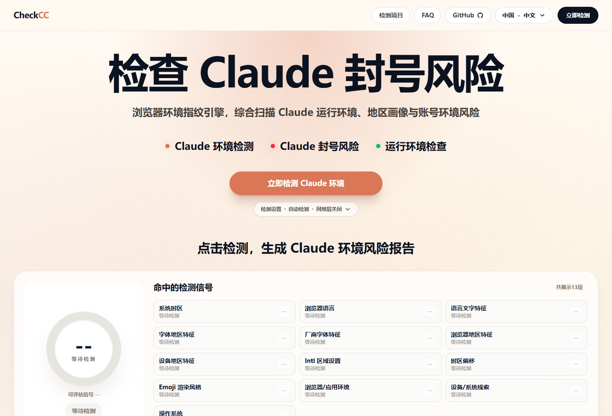
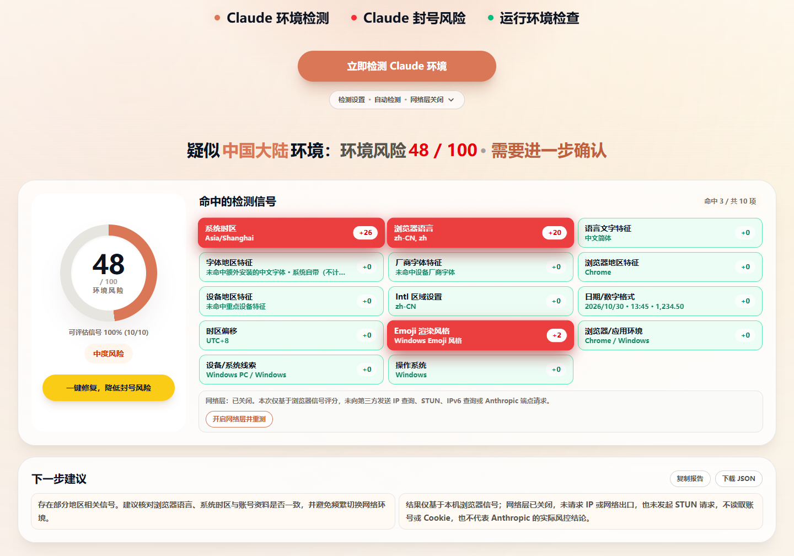
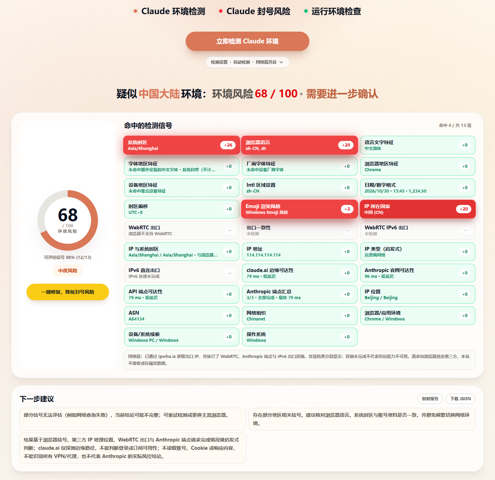
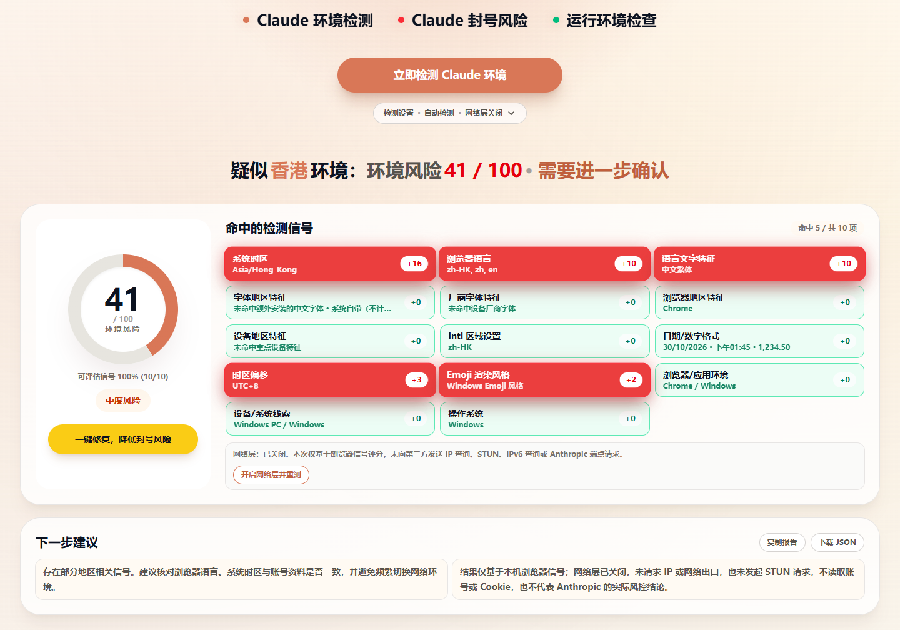
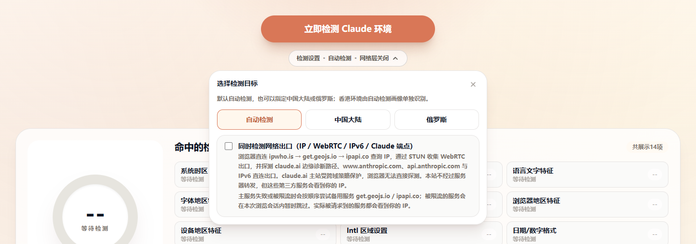
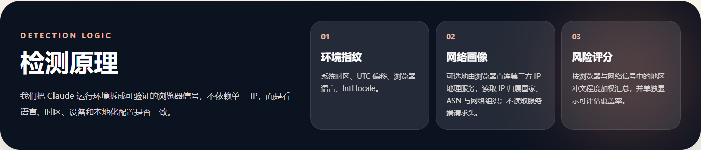
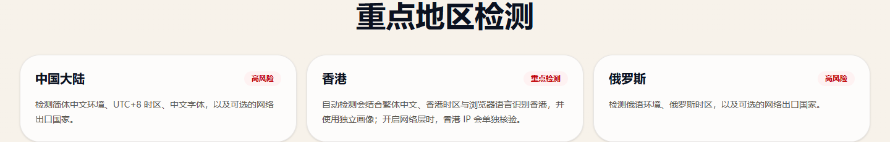
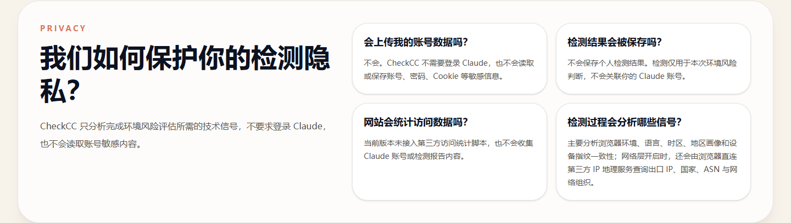

<!-- CheckCC 中文项目说明：面向开源用户介绍项目用途、检测能力边界、开发方式与部署方式。 -->
# CheckCC

<p align="center">
  <strong>检查 Claude 封号风险，先看清浏览器环境画像</strong>
</p>

<p align="center">
  浏览器端环境指纹检测 · 中国大陆 / 香港 / 俄罗斯 / 伊朗画像 · 可选网络层 · 静态自托管
</p>

<p align="center">
  <a href="#项目简介">项目简介</a> ·
  <a href="#页面预览">页面预览</a> ·
  <a href="#功能详解">功能详解</a> ·
  <a href="#快速开始">快速开始</a> ·
  <a href="#自部署">自部署</a> ·
  <a href="README.en.md">English</a>
</p>

---

## 📖 项目简介

**CheckCC** 是一个浏览器端的 Claude 环境检测工具，用来发现系统时区、浏览器语言、Intl 区域、字体、设备特征和网络出口之间的明显冲突。它不登录 Claude，不读取账号、Cookie 或聊天内容，也不把检测结果上传到服务器。

本仓库是 [yacuo/check-cc](https://github.com/yacuo/check-cc) 的社区分支，由 [Brilliant666](https://github.com/Brilliant666) 维护。当前分支重点修正了检测结论的可信度：未评估的信号不再按 0 分处理，报告会显示可评估覆盖率；网络层默认关闭、可按需开启；香港环境使用独立画像，不再归入中国大陆画像。

> 检测结果是启发式风险提示，不代表 Claude 或 Anthropic 的官方判断，也不能证明账号一定会被限制。

### ✨ 核心特性

- 🔍 **10 项浏览器加权信号**：系统时区、浏览器语言、语言文字、地区字体、厂商字体、浏览器地区特征、设备地区特征、Intl 区域、时区偏移、Emoji 渲染风格。
- 🇭🇰 **中国大陆 / 香港 / 俄罗斯 / 伊朗画像**：自动检测分别匹配；繁体中文、香港时区和 `zh-HK` 语言环境会显示为香港，而不是中国大陆。
- 🌐 **可选网络层**：默认关闭；完成浏览器检测后，可以点击“开启网络层并重测”，由浏览器直连第三方 IP 地理服务补充 IP 国家信号。
- 📊 **覆盖率与未检测状态**：只对实际取到值的信号评分；缺失信号不会抬高或压低分数，覆盖率单独展示。
- 🧾 **报告导出**：复制文本报告或下载 JSON，包含分数、覆盖率、逐项原始值、权重与贡献、建议和限制说明。
- 🌏 **四语言界面**：简体中文、繁体中文、俄文、英文，各自有独立 URL 和 `html lang`。
- 🛡️ **隐私优先**：不登录 Claude，不读取账号敏感内容，不接入第三方访问统计脚本。
- 📦 **静态导出**：Next.js 静态导出到 `out/`，可部署到任意静态托管，无 Node 服务端运行时。
- 🐳 **VPS 一键部署**：Docker Compose + Nginx，默认监听 8080，域名和 HTTPS 由你自行接管。

> Maintained by **Brilliant666**，基于 yacuo/check-cc 的 MIT 许可代码。

## 📸 页面预览

### 🏠 首页：一键开始检测



首页直接展示检测入口，不需要先选择目标地区。默认使用自动检测，网络层默认关闭。

### 🔍 浏览器端检测结果



浏览器端检测会展示命中的信号、权重贡献、风险分和覆盖率。上图是一个示例中国大陆环境：时区、语言、字体和 Intl 区域同时命中，覆盖率 `10/10`，未向第三方发送 IP 查询；风险分取决于命中的信号组合。

### 🌐 开启网络层后重测



点击“开启网络层并重测”后，浏览器会直连 `ipwho.is` 查询出口 IP，覆盖率变为 `11/11`，并增加 IP 国家、IP 地址、位置、ASN 和网络组织。只有 IP 国家参与评分。

### 🇭🇰 香港环境独立画像



繁体中文、香港时区和 `zh-HK` 语言环境会归入香港画像，显示“香港”而不是“中国大陆”。浏览器端示例命中香港画像但风险分为中等，需要进一步确认；香港目前不是手动可选目标，由自动检测识别，开启网络层时香港 IP 会单独核验。

### ⚙️ 内联检测设置



检测目标、网络层开关和隐私说明都在页内展开，不弹出模态框。修改检测目标会清空当前结果，需要重新点击检测。

### 🧠 检测原理与重点地区

| 检测原理 | 重点地区 |
| --- | --- |
|  |  |

## 🎯 功能详解

### 检测流程

1. **收集浏览器环境**：读取 `navigator.languages`、`Intl.DateTimeFormat().resolvedOptions()`、时区偏移、User-Agent、UA-CH brands 和 Canvas 字体探测结果。
2. **匹配地区画像**：根据语言、时区、Intl 区域、浏览器/设备特征计算与各画像的重合度，选出最匹配的画像。
3. **计算加权信号**：只有取到值的加权信号参与评分；缺失或查询失败的信号标记为“未检测”。
4. **可选网络层**：如果用户开启网络层，浏览器直连第三方 IP 地理服务，补充 IP 国家、ASN、组织与位置。
5. **生成建议与报告**：根据风险分、覆盖率和限制说明生成下一步建议，可复制文本或下载 JSON。

### 已实现的风险信号

| 信号 | 权重 | 说明 |
| --- | ---: | --- |
| 系统时区 | 26 | 系统时区是否与目标画像一致 |
| 浏览器语言 | 20 | 首选语言是否与目标地区一致 |
| IP 所在国家 | 20 | 网络层可选信号，仅在开启网络层时参与 |
| 字体地区特征 | 16 | 是否命中中国或中文繁体字体 |
| 语言文字特征 | 12 | 简体 / 繁体中文特征 |
| 厂商字体特征 | 10 | MiSans、HarmonyOS Sans、OPPO Sans 等 |
| 浏览器地区特征 | 8 | 微信、QQ、UC、夸克等国产浏览器或 WebView |
| 设备地区特征 | 6 | 华为、荣耀、小米、OPPO、vivo 等设备线索 |
| Intl 区域设置 | 6 | JavaScript 国际化环境暴露的区域 |
| 时区偏移 | 4 | UTC 偏移是否与画像一致 |
| Emoji 渲染风格 | 4 | Apple / Android / Windows Emoji 风格 |

另有浏览器/应用环境、设备/系统线索、操作系统 3 项浏览器上下文，以及 IP 地址、IP 位置、ASN、网络组织 4 项网络上下文，只用于展示，不参与评分。

### 评分方式

- 风险分是已评估信号贡献之和，封顶 100；未评估信号不会抬高或压低分数。
- 覆盖率单独展示，例如 `100% (10/10)` 表示 10 项加权浏览器信号全部完成评估；开启网络层后变为 `11/11`。
- 网络查询失败时，国家信号显示为“查询失败/未检测”，覆盖率下降，但不会把缺失的 20 分权重放大成风险。
- 国家信号只在 IP 国家命中目标画像时计分；自动检测下，中国大陆、香港、俄罗斯或伊朗 IP 都会计分。
- 自动检测会分别匹配中国大陆、香港、俄罗斯和伊朗画像；繁体中文、香港时区和 `zh-HK` 语言环境归入香港画像。
- 手动目标提供中国大陆和俄罗斯；香港和伊朗由自动检测识别。
- 分数是启发式风险提示，不代表 Anthropic 的实际风控结论；IP 地理位置无法识别 VPN、代理或中转。

### 报告导出

检测完成后可以复制文本报告或下载 JSON。报告包含：

- 风险分、覆盖率、命中数量
- 每项信号的原始值、权重、贡献和评估状态
- 按风险等级生成的下一步建议
- 当前检测的限制说明

开启网络层时，报告还会包含查询到的 IP、国家、ASN 和网络组织。报告在浏览器本地生成；分享前请注意其中可能包含你的出口 IP。

### 能力边界

| 能力 | 状态 |
| --- | --- |
| 浏览器端环境采样 | 已实现 |
| 10 项加权浏览器信号 | 已实现 |
| 1 项可选加权网络信号（IP 所在国家，默认不请求） | 已实现 |
| 网络层 IP / ASN / 组织 / 位置展示 | 已实现（浏览器直连第三方） |
| 3 项环境上下文 + 4 项网络上下文（不计分） | 已实现 |
| 中国大陆、香港、俄罗斯、伊朗地区画像 | 已实现 |
| 网络层开关与隐私说明 | 已实现（默认关闭，可按需开启） |
| 覆盖率与“未检测”状态 | 已实现 |
| 按风险等级生成下一步建议 | 已实现 |
| 复制文本报告 / 下载 JSON | 已实现 |
| 中文、繁体中文、俄文、英文 | 已实现 |
| 静态导出与自部署 | 已实现 |
| 代理 / VPN 识别 | 不实现（只反映出口 IP 的地理位置） |
| 读取账号、Cookie、聊天内容 | 不实现 |
| 桌面端一键修复 | 不在本仓库范围 |

### 🔒 隐私设计



- 检测不需要登录 Claude，不读取账号、密码、Cookie 或聊天内容。
- 网络层默认关闭；默认检测只使用浏览器信号，不向第三方发送 IP 查询。
- 开启网络层时，浏览器直接请求配置的第三方 IP 地理服务（默认 `ipwho.is`），该服务会看到你的公网 IP；请求不经过本站服务器，本站不接收、不转发、不存储查询结果。
- 请求使用 `credentials: "omit"` 和 `no-referrer`，不携带 Cookie 或来源页面。
- 检测结果不会自动上传；报告由浏览器本地生成。
- 当前版本未接入第三方访问统计脚本。

## 🛠️ 技术栈

| 技术 | 版本 | 用途 |
| --- | --- | --- |
| **Next.js** | 16.2.10 | App Router、静态导出 |
| **React** | 19.2.4 | 检测界面与交互 |
| **TypeScript** | 5.9.3 | 类型约束与检测数据结构 |
| **Tailwind CSS** | 4 | 响应式界面 |
| **Vitest** | 3.2.4 | 单元测试 |
| **pnpm** | 9 | 依赖管理 |

项目使用 `output: "export"` 生成纯静态站点，没有服务端运行时；IP 查询由浏览器直接发起。

## 📁 项目结构

```text
review-check-cc/
├─ src/
│  ├─ app/
│  │  ├─ (zh)/                    # 中文根布局与首页
│  │  ├─ (intl)/[locale]/         # 香港、俄罗斯、英文页面
│  │  ├─ robots.ts                # robots.txt
│  │  └─ sitemap.ts               # sitemap.xml
│  ├─ components/
│  │  ├─ detector/Detector.tsx    # 检测流程、设置、报告导出
│  │  ├─ home/HomeContent.tsx     # 首页内容与结构化数据
│  │  └─ layout/                  # 页头、页脚、移动菜单
│  ├─ detection/
│  │  ├─ client-engine.ts         # 浏览器环境采样与信号评分
│  │  ├─ scoring.ts               # 地区画像匹配
│  │  ├─ ip-intel.ts              # 可选网络层查询与解析
│  │  ├─ report.ts                # 文本 / JSON 报告
│  │  ├─ config/                  # 信号权重、服务与步骤配置
│  │  └─ __tests__/               # 单元测试
│  ├─ i18n/                       # 四语言文案与元信息
│  └─ regions/                    # 中国大陆 / 香港 / 俄罗斯 / 伊朗画像
├─ docs/images/                   # README 截图
├─ deploy/                        # VPS Docker 部署脚本与 Nginx 配置
├─ Dockerfile                     # 多阶段构建：静态导出 + Nginx
├─ docker-compose.yml             # VPS 一键启动配置
├─ .env.example                   # 部署环境变量模板
├─ shell/deploy-restart-hot.sh    # 本地一键启动脚本
├─ next.config.ts                 # 静态导出配置
└─ package.json
```

## ⚙️ 环境要求

| 环境 | 版本要求 | 说明 |
| --- | --- | --- |
| **Node.js** | >= 20.9 | Next.js 16 要求 |
| **pnpm** | 9 | 推荐包管理器 |
| **操作系统** | Linux / macOS / Windows | 跨平台 |
| **浏览器** | 现代 Chrome / Edge / Safari / Firefox | 需要 Canvas 与 Intl 支持 |

## 🚀 快速开始

```bash
# 1. 安装依赖
pnpm install

# 2. 启动开发服务（默认 5000 端口）
pnpm dev

# 3. 打开 http://localhost:5000
```

### 构建与预览

```bash
pnpm build      # 静态导出到 out/
pnpm preview    # 在 http://localhost:4173 预览 out/
```

本项目没有 Node 服务端运行时，因此不要使用 `next start`。

## 📦 自部署

### 方式一：VPS 一键部署（Docker + Nginx，推荐）

适用于 Ubuntu / Debian，需要 Docker Engine 20.10+（建议 24+）和 Docker Compose v2：

```bash
git clone https://github.com/Brilliant666/check-cc.git
cd check-cc
cp .env.example .env
# 编辑 .env，至少设置 NEXT_PUBLIC_SITE_URL
./deploy/deploy.sh
```

脚本会构建静态站点、启动 Nginx 容器并等待健康检查通过，默认监听 `0.0.0.0:8080`。域名、HTTPS 和反向代理由你自行配置；如果前面已有 Nginx / Caddy，建议改为只监听本机：

```bash
CHECKCC_BIND=127.0.0.1 ./deploy/deploy.sh
```

完整的 VPS 部署说明、反向代理示例和更新命令见 [deploy/README.md](./deploy/README.md)。

### 方式二：手动静态托管

将 `out/` 目录部署到任意静态托管即可，例如 Cloudflare Pages、Netlify、Vercel 或自己的 Nginx：

```bash
pnpm install
pnpm build
# 将 out/ 作为站点根目录
```

### 站点身份配置

页面默认不声明 canonical、hreflang 或 OG URL，页头和页脚的 GitHub 链接指向本仓库。部署时通过环境变量设置站点公开地址：

| 变量 | 默认值 | 说明 |
| --- | --- | --- |
| `NEXT_PUBLIC_SITE_URL` | 空 | 站点公开地址，例如 `https://your-domain.example`。设置后才生成 canonical、hreflang、OG URL 和 JSON-LD URL；未设置时这些字段不输出，避免指向错误站点 |
| `NEXT_PUBLIC_REPO_URL` | `https://github.com/Brilliant666/check-cc` | 页头、页脚和页脚源码入口使用的 GitHub 仓库地址 |

这些变量在构建时读取，修改后需要重新构建。页脚保留 yacuo/check-cc 的 MIT 归属链接，不受上述配置影响。

### 网络层配置

网络层配置在构建时读取环境变量，修改后需要重新构建：

| 变量 | 默认值 | 说明 |
| --- | --- | --- |
| `NEXT_PUBLIC_IP_INTEL_ENABLED` | `true` | 设为 `false` 时彻底关闭网络层，界面不显示开关，也不发送 IP 查询。设为 `true` 只提供按需开启的选项，首次检测仍默认不请求 IP |
| `NEXT_PUBLIC_IP_INTEL_ENDPOINT` | `https://ipwho.is/` | 必须是支持 CORS 的 HTTPS 接口；浏览器会直接请求它 |

接口可以返回 ipwho.is 的原始结构，也可以返回下面的扁平结构：

```json
{
  "ip": "203.0.113.10",
  "country_code": "US",
  "country": "United States",
  "region": "California",
  "city": "Los Angeles",
  "asn": "AS15169",
  "org": "Example Network",
  "isp": "Example ISP",
  "latitude": 34.05,
  "longitude": -118.24,
  "type": "IPv4"
}
```

查询超时为 3500ms（见 `src/detection/config/services.ts`）。超时、跨域失败、返回格式异常或返回内网/保留地址时，页面会跳过 IP 信号并显示失败原因，不会把失败当成 0 风险，也不会抬高分数。

## 🧪 开发与校验

```bash
pnpm lint        # ESLint
pnpm typecheck   # TypeScript
pnpm test        # Vitest，62 项测试
pnpm check       # lint + typecheck + test
pnpm build       # 静态导出
```

GitHub Actions 会在 push 和 pull request 时执行 lint、类型检查、单元测试和静态构建。

测试覆盖评分不因覆盖率不足而放大、未知信号、零权重信号、IP 地址分类、IP 查询解析/超时/失败、国家画像匹配、香港与大陆画像区分、报告导出和多语言文案完整性。

## 🗺️ 页面路由

| 路由 | 语言 | 说明 |
| --- | --- | --- |
| `/` | 简体中文 | 默认页面 |
| `/hong-kong/` | 繁体中文 | 香港页面 |
| `/russia/` | 俄文 | 俄罗斯页面 |
| `/en/` | 英文 | 国际页面 |
| `/robots.txt` | — | 抓取规则 |
| `/sitemap.xml` | — | 站点地图（内容仅在设置 `NEXT_PUBLIC_SITE_URL` 时生成） |

## 🐛 常见问题

### 1. 第一次检测没有查询 IP，是正常的吗？

正常。网络层默认关闭，首次检测只使用浏览器信号，覆盖率通常显示 `10/10`。如果希望补充 IP 国家信号，可以点击结果下方的“开启网络层并重测”。

### 2. 为什么香港 IP 没有单独计分？

香港不是手动可选目标，由自动检测画像识别。网络层关闭时，只根据浏览器信号判断；开启网络层后，香港 IP 会作为网络信号单独核验。

### 3. 网络层查询失败会影响分数吗？

不会。查询失败时，国家信号显示为“查询失败/未检测”，覆盖率下降，但分数不会因为缺失的 20 分权重被放大。

### 4. 检测结果能证明账号安全吗？

不能。检测只反映当前浏览器环境和可选的出口 IP 位置，不能预测 Claude 账号状态，也不代表 Anthropic 的实际风控结论。

### 5. 为什么静态部署后 canonical 或 sitemap 为空？

需要设置 `NEXT_PUBLIC_SITE_URL` 后重新构建。未设置时，项目会省略 canonical、hreflang、OG URL 和 sitemap 内容，避免指向错误站点。

### 6. 可以关闭网络层吗？

可以。自部署时设置 `NEXT_PUBLIC_IP_INTEL_ENABLED=false`，界面不会显示网络层开关，也不会发送 IP 查询。也可以在检测前关闭设置中的网络层开关。

## 📝 更新日志

### 当前版本

- 网络层改为默认关闭，首次检测不发送 IP 查询
- 新增“开启网络层并重测”，按需补充 IP 国家信号
- 新增香港独立画像，繁体中文 / 香港时区不再归入中国大陆
- 新增 Docker + Nginx VPS 一键部署脚本
- 四语言文案、README 和隐私说明同步更新
- 62 项单元测试、类型检查、Lint 和静态构建通过

### 未来计划

- 补充更多地区画像与真实设备样本
- 改进报告中的地区归属展示
- 评估可选的本地检测 / 修复工具

## 🤝 贡献指南

欢迎提交 Issue 或 Pull Request：

1. Fork 本仓库
2. 创建分支：`git checkout -b feature/your-feature`
3. 提交修改并补充测试
4. 推送分支并创建 Pull Request

提交前请先运行：

```bash
pnpm check
pnpm build
```

## 📧 问题反馈

请通过 GitHub Issues 反馈：<https://github.com/Brilliant666/check-cc/issues>

## 💡 致谢

感谢 [yacuo/check-cc](https://github.com/yacuo/check-cc) 提供上游代码与检测思路；感谢 Next.js、React、Tailwind CSS、Vitest 等开源项目。

## 📄 开源协议与来源

本项目基于 MIT 协议开源，Copyright © yacuo / CheckCC。

你可以自由使用、修改与再分发本项目。任何副本、二次开发版本、自部署站点或项目的实质性部分，都必须保留原始版权与许可声明，并注明来源：<https://github.com/yacuo/check-cc.git>。

如果你重新部署本项目，请保留页脚署名或仓库链接，方便访问者找到原项目。

本分支的修改同样以 MIT 协议发布。上游项目与本分支没有隶属关系；上游 README 中的在线演示、桌面端计划和反馈群信息不适用于本分支。

## ⚠️ 免责声明

CheckCC 的检测结果仅基于浏览器本地环境信号和可选的第三方 IP 地理位置进行风险提示，不代表 Claude 或 Anthropic 官方判断。IP 地理位置可能不准确，也无法识别 VPN、代理或中转。请勿将检测结果作为账号安全、订阅状态或申诉结果的唯一依据。
